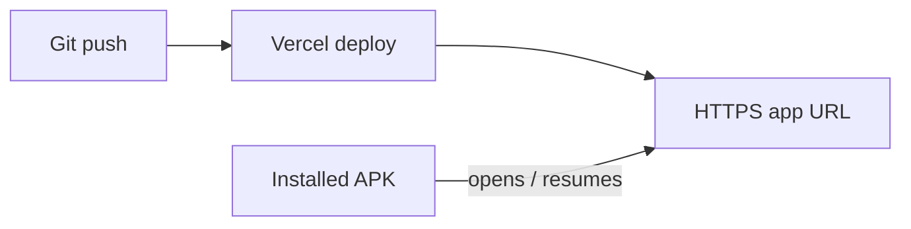

# Live updates on installed phones (push → app updates)

Use this when the team should **install the APK once**, and **git push** should update the app **without reinstalling**.

## How it works



1. You host the Next.js app on **Vercel** (or similar).
2. Every **push** redeploys the site.
3. The APK is a thin shell: it opens your **HTTPS URL** when the phone has internet.
4. When the user returns to the app, it **reloads** so they see the latest deploy.

Job data still lives on the phone (`localStorage` / IndexedDB). Only the **app UI and logic** update from the server.

---

## One-time setup

### 1. Deploy the web app

1. Push this repo to **GitHub**.
2. Go to [vercel.com](https://vercel.com) → **Add New Project** → import the repo.
3. Build command: `npm run build` (default).
4. Deploy and copy the URL, e.g. `https://shivshakti-proerp.vercel.app`.

Do **not** set `CAPACITOR_OFFLINE_BUILD` on Vercel.

### 2. Point the mobile shell at that URL

In the project root, create `.env.local`:

```env
CAPACITOR_SERVER_URL=https://your-project.vercel.app
```

(Use your real Vercel URL, **https**, no trailing slash.)

### 3. Build and share the live APK **once**

**Mac:**

```bash
cd "/path/to/NEW UPVC"
npm install
npm run build:apk:live
```

**Windows:** same after JDK/SDK setup — `npm run build:apk:live`

APK path: `android/app/build/outputs/apk/debug/app-debug.apk`

Upload to Google Drive / WhatsApp and have the team install **one time**.

---

## Day-to-day workflow

| Step | Action |
|------|--------|
| 1 | Change code locally |
| 2 | `git push` |
| 3 | Vercel finishes deploy (~1–2 min) |
| 4 | Team opens the app (with internet) → latest version |

No new APK for normal app changes.

---

## Requirements

| Item | Live APK |
|------|----------|
| Internet | Required for **updates** (and for first load of new UI) |
| Offline | Falls back to the **last bundled snapshot** from when the APK was built (older UI) |
| API routes (`/api/...`) | Work when loading from Vercel; limited in pure offline fallback |

---

## Offline-only APK (old behaviour)

Fully offline, no auto-update from push:

```bash
npm run build:apk
```

---

## Rebuild the live shell when

- You change **native** plugins, app id, icons, or Capacitor config
- You change `CAPACITOR_SERVER_URL` (new domain)

Then run `npm run build:apk:live` again and redistribute the APK.
